# Olá, eu sou o Mizael Borges! 👋

Sou um **Desenvolvedor Full Stack** focado em construir aplicações web modernas, escaláveis e de alta performance. Minha paixão é transformar problemas complexos em interfaces elegantes e códigos eficientes, utilizando as melhores práticas do mercado.

---

### 🛠️ Minha Stack Principal

* **Frontend:** React, Next.js (App Router), TypeScript, Tailwind CSS, shadcn/ui.
* **Gerenciamento de Estado & Requisições:** TanStack Query (React Query), React Hook Form.
* **Backend & Banco de Dados:** Node.js, Server Actions, PostgreSQL (Supabase), Prisma ORM.
* **Validação:** Zod (integrado ao React Hook Form e às Server Actions).
* **Autenticação & Segurança:** Better Auth, JWT, controle de acesso por papéis, rate limit.
* **Qualidade & Testes:** Vitest, Playwright, ESLint, Prettier, GitHub Actions.
* **Serviços & Observabilidade:** Resend (e-mail), Sentry, PostHog, Vercel.

---

### 🚀 Tecnologias e Ferramentas

  
  
  
  
  
  
  
  
  
  
  
  
  
  
  
  
  

#### No meu radar e ecossistema:
* Arquitetura de software limpa, APIs RESTful.
* Jobs em background e tarefas agendadas (cron/filas).
* Integrações com APIs externas (WhatsApp, Google Calendar).
* Cobrança recorrente e planos (Stripe / Asaas).
* Row Level Security no PostgreSQL e otimização de consultas.
* Docker e deploy automatizado.
* LGPD e boas práticas de proteção de dados.

---

### 📈 Estatísticas do GitHub

  
  

---

### 📫 Vamos nos conectar?

Seja para conversar sobre um projeto, uma oportunidade de trabalho ou apenas trocar ideias sobre tecnologia, sinta-se à vontade para me dar um alô!

* 💼 **LinkedIn:** [MizaelSemM](https://www.linkedin.com/in/mizaelsemm)
* 📧 **E-mail:** [mizaelborges44444@gmail.com](mailto:mizaelborges44444@gmail.com)
* 🌐 **Portfólio:** [MizaelSemM-Portfólio](https://portif-lio-tawny-eta.vercel.app/)
